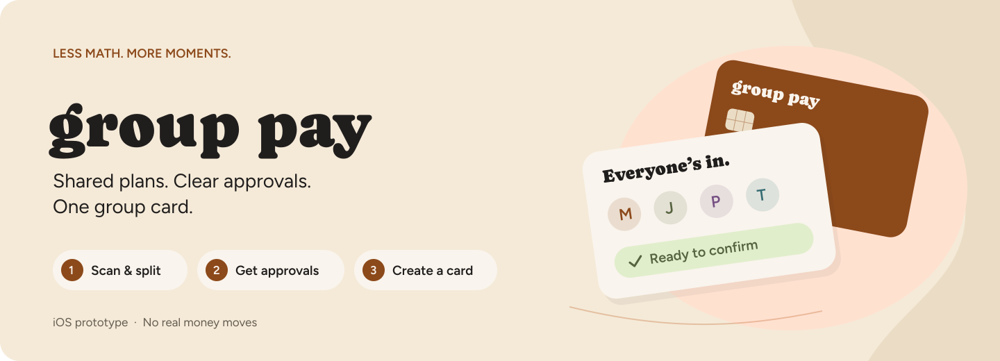

<p align="center">
  
</p>

<p align="center">
  <strong>Shared plans. Clear portions. One group card.</strong><br />
  A native iOS prototype for roommates, friends, and the everyday costs they share.
</p>

<p align="center">
  
  
  
  
</p>

<p align="center">
  <a href="#how-it-works">How it works</a> ·
  <a href="#try-it">Try it</a> ·
  <a href="docs/DEVELOPMENT.md">Development guide</a> ·
  <a href="sandbox_backend/cloud/README.md">Cloud backend</a>
</p>

## One bill. Everyone’s part.

A grocery run for the house. Dinner with friends. The internet bill that comes around every month. Group Pay gives everyone a clear view of their share and collects approvals before the organizer creates a group card.

**This is a working prototype with simulated money.** It supports local mock cards and Marqeta sandbox card issuance. It does not charge people, hold their funds, or pay real merchants.

## How it works

1. **Bring the bill.** Scan a receipt, import a photo, or enter the amount. Review the subtotal, tax, and items before sharing.
2. **Choose your people.** Add participants or pick saved friends and groups. Split equally, enter custom amounts, or assign individual items.
3. **Review and approve.** Each person sees their portion, chooses their tip, and approves. App participants use private iCloud sharing; guests can use a personal webpage.
4. **Create the test card.** Once everyone has joined and approved, the organizer confirms. The card covers the purchase and tips; only the organizer sees its details.

Local mock cards include a simulated payment step. Marqeta sandbox cards support issuance and initial test funding; merchant transactions and subsequent balance updates are not implemented.

## Built for the way groups spend

| Feature | What you can do |
| --- | --- |
| **Receipts and groceries** | Scan multiple pages or import a photo, then correct the on-device OCR result before creating a split. |
| **Flexible portions** | Split equally, use custom subtotal amounts, or assign items—including shared items—with exact-cent allocation. |
| **Personal tips** | Adjust your own percentage or exact amount. Dining starts at 20% of your subtotal; other categories start at 0%. |
| **Friends and groups** | Connect in People before creating a bill. Accepted, reusable group invitations let future bills inherit access. |
| **Guest approvals** | Send a named participant a seven-day web link. They can review and approve without installing the app or creating an account. |
| **Recurring expenses** | Set a weekly or monthly schedule. The organizer starts each cycle, and everyone approves again. |
| **Status and cancellation** | Follow approvals in Inbox, receive bill-update notifications, or cancel before card creation starts. |
| **Private card details** | Everyone sees card-ready status; card metadata stays in the organizer’s private iCloud records. |

The interface uses warm cream and terracotta, **Caprasimo** headings, and **Figtree** body text, with scalable type and support for reduced motion.

### Clear amounts, down to the cent

The current app applies a **1% fee to subtotal plus tax, excluding tips**. Contributions include the fee; the test card receives only subtotal, tax, and tips. There is no additional fixed charge in this build. All fees are simulated accounting.

For example, a $120 purchase with no tax or tip produces $121.20 in total contributions: four equal portions of $30.30 and a $120 test card.

## Try it

### Explore in the simulator

```sh
git clone https://github.com/itsfloppyhat/GroupPay.git
cd GroupPay
open GroupPay.xcodeproj
```

Select the **GroupPay** scheme and an iPhone simulator running **iOS 26 or later**, then run. The project uses Swift 6 and was built with the iOS 27.2 SDK. A compatible Xcode installation is required; the iOS app has no third-party package dependencies.

- Add `--preview` to the scheme’s launch arguments for a read-only sample dashboard.
- In a Debug simulator build, open **Profile → Roommate recording demo** for the interactive demo. Start **Matthew · Leader** on one simulator, then **Dylan · Saved friend** on another. A third participant can approve through the guest webpage.

The recording demo runs locally, calls no iCloud or Marqeta service, and loses its session when the leader app closes. See the [demo walkthrough](docs/DEVELOPMENT.md#verification-history) for setup and browser instructions.

### Share with real iCloud accounts

Use two physical devices running iOS 26+, separate iCloud accounts, and a developer team configured for CloudKit and push notifications. Open **Profile** to connect iCloud, set a display name, and enable notifications. Connect friends through **People → Add friend**, then create a split.

The checked-in project uses the original developer’s signing team, bundle ID, and iCloud container. Configure your own identifiers and capabilities for a separate deployment. The [development guide](docs/DEVELOPMENT.md#test-on-two-real-accounts) covers signing, first invitations, saved groups, and CloudKit schema setup.

### Add Marqeta test cards

Choose a backend for your testing environment:

- **On your Mac:** the [local backend](sandbox_backend/README.md) runs on loopback for simulator testing. Its setup tool stores credentials in an ignored, private `.env` file.
- **For your team’s phones:** the [Cloud Run backend](sandbox_backend/cloud/README.md) provides HTTPS, Firestore recovery, and Secret Manager storage. Testers join through **Profile → Team access**.

Marqeta credentials stay on the backend. Never add them to the app or commit them to this repository. Guest webpages require the updated hosted backend; the standalone local card server does not serve them.

## Under the hood

| Layer | Technology |
| --- | --- |
| iOS app | Swift 6, SwiftUI, iOS 26+ |
| Receipt scanning | Vision and VisionKit, processed on-device |
| Account and bill sharing | iCloud identities, private/shared CloudKit databases |
| Notifications | CloudKit push registration and local notification handling |
| Local card service | Python 3.11+, SQLite, Marqeta sandbox API |
| Hosted service | Flask, Gunicorn, Cloud Run, Firestore, Secret Manager |
| Guest page | HTML, CSS, and JavaScript with portion-scoped, expiring access |
| Project configuration | XcodeGen; generated Xcode project committed for direct opening |

```text
GroupPay/                  SwiftUI screens, domain models, CloudKit services
  Fonts/                   Caprasimo and Figtree, with their font license
Tests/                     Swift checks and cross-language pricing fixtures
sandbox_backend/           Local and hosted test-card services
  guest_web/               Personal guest approval page
  cloud/                   Deployment and operations tools
docs/                      Development guide and project artwork
```

## Check your changes

From the repository root, run the app’s domain checks:

```sh
xcrun swiftc -swift-version 6 GroupPay/Models.swift Tests/DomainChecks.swift -o /tmp/group-pay-domain-checks
/tmp/group-pay-domain-checks
```

Run the guest approval and notification checks:

```sh
xcrun swiftc -swift-version 6 GroupPay/Models.swift Tests/GuestChecks.swift -o /tmp/group-pay-guest-checks
/tmp/group-pay-guest-checks
xcrun swiftc -swift-version 6 GroupPay/Models.swift GroupPay/FriendsGroups.swift Tests/NotificationChecks.swift -o /tmp/group-pay-notification-checks
/tmp/group-pay-notification-checks
```

For the backend and browser checks, use Python 3.11+ and Node.js:

```sh
python3 -m venv /tmp/group-pay-venv
/tmp/group-pay-venv/bin/python -m pip install -r sandbox_backend/requirements-cloud.txt
(cd sandbox_backend && /tmp/group-pay-venv/bin/python -m unittest test_server test_storage test_cloud_app test_guest)
node --test sandbox_backend/test_guest_web.js
```

These backend suites use mocked provider calls and isolated test storage. Additional receipt checks, pricing-contract fixtures, device builds, and recorded validation are in the [development guide](docs/DEVELOPMENT.md#verification-history).

## Prototype boundaries

- **Approvals are consent within the demo.** They do not reserve or collect money. Bank linking, settlement, refunds, Apple Pay, and automatic card relocking are outside this build.
- **Sharing needs an accepted connection.** Saving a name alone does not grant bill access. Reusable groups require their own initial invitation.
- **Guest approvals sync when the organizer refreshes.** They do not directly send CloudKit notifications. The app also checks them before card creation.
- **Recurring bills require a new decision.** Each cycle starts manually and needs fresh approvals; there is no scheduled payment job.
- **This is for a trusted beta group.** CloudKit controls sharing access, but the backend trusts the app’s participant and approval claims. Real-money use requires independent identity verification, server-enforced authorization, and payment reconciliation.

For API contracts, recovery behavior, limits, and deployment notes, start with the [development guide](docs/DEVELOPMENT.md), [local backend guide](sandbox_backend/README.md), or [cloud operations guide](sandbox_backend/cloud/README.md).

---

Typography: [Caprasimo](https://github.com/docrepair-fonts/caprasimo-fonts) and [Figtree](https://github.com/erikdkennedy/figtree), distributed under the [SIL Open Font License](GroupPay/Fonts/OFL.txt).
